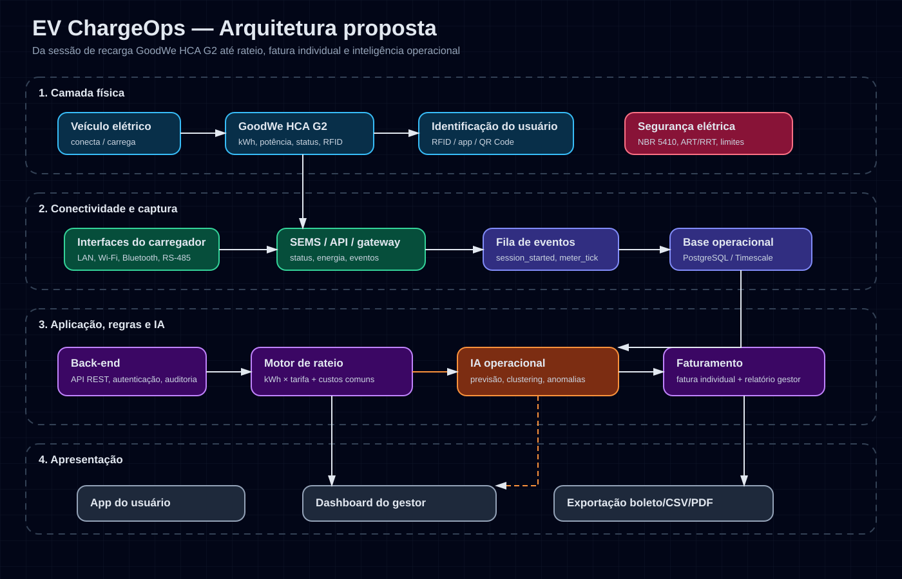

# EV ChargeOps — Enterprise Challenge 2026

> **Sprint 01 — Pesquisa e documentação**  
> Projeto para transformar sessões de recarga de veículos elétricos em uma infraestrutura compartilhada com dados estruturados, rateio justo e inteligência acionável.

## 1. Equipe

- **Nome da equipe:** `FIAP 404`
- **Repositório:** https://github.com/FIAP-404/ev-chargeops-sprint01
- **Integrantes e RMs:**
  - `Fernando dos Santos Motta` — RM `RM570046`
  - `Joedson da Silva Souza` — RM `RM573981`
  - `Caetano de Medeiros Bona` — RM `RM569262`
  - `Erik Fabiano de Jesus Appe` — RM `RM571067`
  - `Mylena Ramalho da Silva Torquato` — RM `RM572383`

## 2. Descrição do problema e contexto do desafio

A GoodWe é uma fabricante global de inversores e sistemas de armazenamento de energia, com presença internacional e soluções conectadas para energia solar, armazenamento e recarga de veículos elétricos. No contexto do desafio, a FIAP possui no Energy Innovation Lab um carregador GoodWe HCA G2 instalado em ambiente compartilhado.

O problema central não é apenas carregar veículos. O desafio está em **operar a recarga como um serviço compartilhado**, em que diferentes usuários utilizam a mesma infraestrutura e precisam de identificação, registro de consumo, regras de rateio, transparência e controle operacional.

Na visão da equipe, esse é principalmente um problema de **confiança e organização**. Se o condomínio ou campus não consegue mostrar quem usou, quanto consumiu e como o valor foi calculado, a recarga vira motivo de conflito mesmo quando o carregador funciona corretamente.

Em condomínios, edifícios corporativos e campus universitários, os principais desafios são:

- identificar corretamente quem usou o carregador;
- medir energia entregue em cada sessão, em kWh;
- separar consumo individual de custos coletivos da infraestrutura;
- evitar conflitos por fila, tempo de permanência e ociosidade;
- garantir segurança elétrica, conformidade técnica e rastreabilidade;
- entregar relatórios simples para síndicos, gestores e usuários;
- transformar dados de uso em decisões: expansão de pontos, horários de pico, previsão de demanda e detecção de uso anormal.

A proposta do **EV ChargeOps** é criar uma plataforma que conecte o carregador, registre sessões de recarga, aplique um modelo de rateio e use IA para gerar previsões, alertas e recomendações operacionais. A equipe entende que a solução precisa ser simples de auditar: qualquer usuário deve conseguir entender de onde veio o valor cobrado.

## 3. Frente 1 — Contexto e problema

### 3.1 Infraestruturas de recarga compartilhada

Infraestruturas de recarga compartilhada são pontos de carregamento usados por mais de um usuário ou unidade. Elas podem existir em:

- condomínios residenciais;
- prédios comerciais;
- estacionamentos corporativos;
- universidades;
- shoppings;
- frotas empresariais;
- garagens públicas ou semipúblicas.

Diferente de um carregador residencial privado, o carregador compartilhado precisa controlar **acesso, medição, cobrança ou rateio, disponibilidade e manutenção**. Sem esse controle, o custo da energia pode ser repassado de forma injusta para todos, inclusive para quem não usa o serviço.

Nossa análise é que o maior ponto de atrito não está no equipamento em si, mas na **governança do uso**: quem pode carregar, quando pode carregar, quanto consumiu e como esse custo será atribuído.

### 3.2 Como funciona uma sessão de recarga

Uma sessão de recarga pode ser descrita em etapas:

1. **Autenticação:** o usuário se identifica por RFID, aplicativo, QR Code ou liberação pelo gestor.
2. **Conexão física:** o cabo é conectado ao veículo e ao carregador.
3. **Negociação elétrica:** carregador e veículo validam condições mínimas de segurança e potência disponível.
4. **Início da sessão:** a plataforma registra usuário, carregador, horário inicial, status e leitura inicial de energia.
5. **Medição contínua:** durante a sessão são coletados potência instantânea, energia acumulada, duração e eventos.
6. **Encerramento:** a sessão termina por carga completa, ação do usuário, falha, desconexão ou limite operacional.
7. **Processamento:** a plataforma calcula kWh consumidos, custo, regras de rateio e indicadores.
8. **Relatório/fatura:** usuário e gestor recebem o resultado da sessão e do período.

Dados gerados por sessão:

- ID da sessão;
- ID do usuário/unidade;
- ID do carregador;
- início e fim;
- duração total;
- kWh entregues;
- potência média e máxima;
- status final;
- eventos de erro/interrupção;
- custo calculado;
- eventual tempo ocioso após carga completa.

### 3.3 Modelos de negócio para recarga compartilhada

Foram identificados os seguintes modelos:

- **Recarga gratuita:** comum em ações promocionais, empresas ou universidades. Simples para o usuário, mas pouco sustentável se o uso crescer.
- **Cobrança por kWh:** modelo mais justo, pois relaciona cobrança ao consumo real de energia. Depende de medição confiável.
- **Cobrança por tempo:** útil para reduzir ociosidade, mas pode ser injusta quando veículos carregam em potências diferentes.
- **Assinatura mensal:** previsível para o operador, mas exige limites para evitar uso abusivo.
- **Rateio condominial:** adequado para condomínios, desde que separe consumo individual, perdas/custos comuns e manutenção.
- **Modelo híbrido:** kWh consumido + taxa fixa de infraestrutura + taxa de ociosidade. É o modelo adotado nesta proposta.

### 3.4 Opção de aprofundamento escolhida — A: análise de mercado

#### Solução 1 — ChargePoint

- **Problema que resolve:** gestão de recarga em apartamentos, condomínios, empresas e redes públicas.
- **Funcionalidades principais:** autenticação por app/cartão, controle de acesso, cobrança por grupo de usuários, relatórios, fila de espera, monitoramento remoto, gestão de energia e reembolso ao operador.
- **Modelo de negócio:** venda/instalação de estações, planos de rede, serviços de manutenção e ChargePoint as a Service.
- **Limitações:** solução robusta, porém dependente do ecossistema ChargePoint; pode ter custo elevado e menor adaptação a realidades brasileiras de condomínio.

#### Solução 2 — Wallbox Pulsar Pro / ecossistema Wallbox

- **Problema que resolve:** recarga em espaços compartilhados como prédios, frotas e empresas.
- **Funcionalidades principais:** RFID, aplicativo, conectividade, OCPP, medição interna, gerenciamento remoto e balanceamento dinâmico de carga.
- **Modelo de negócio:** venda de hardware e software/serviços associados.
- **Limitações:** o foco está no carregador e no gerenciamento de energia; o rateio condominial brasileiro e relatórios personalizados podem exigir integração externa.

#### Solução 3 — Zaptec Pro

- **Problema que resolve:** implantação escalável de carregadores em edifícios, estacionamentos e instalações comerciais.
- **Funcionalidades principais:** carregamento inteligente, app para usuário, histórico de recarga, controle de acesso e gestão de múltiplos carregadores.
- **Modelo de negócio:** venda de carregadores conectados e serviços digitais.
- **Limitações:** solução internacional, com dependência de ecossistema próprio e necessidade de adequação a regras locais brasileiras.

#### Solução 4 — NeoCharge

- **Problema que resolve:** implantação de carregadores e eletropostos no Brasil, com foco em venda, instalação e suporte.
- **Funcionalidades principais:** consultoria, instalação, fornecimento de equipamentos, calculadoras e conteúdos de mercado.
- **Modelo de negócio:** venda de soluções completas de recarga, instalação e projetos.
- **Limitações:** a comunicação pública enfatiza infraestrutura e implantação; a profundidade de software de rateio e IA operacional não é tão clara quanto em plataformas globais de rede.

#### Conclusão da análise de mercado

As soluções existentes mostram que o mercado já valoriza autenticação, medição e gestão remota. Porém, o EV ChargeOps se diferencia por focar no cenário educacional/condominial brasileiro, com:

- rateio transparente;
- regras de exceção explícitas;
- adequação regulatória brasileira;
- IA como apoio operacional e não apenas recurso visual;
- possibilidade de integração com GoodWe HCA G2 e APIs complementares.

### 3.5 Opção adicional — C: dados públicos e tendência de crescimento

A ABVE informa séries históricas de veículos eletrificados no Brasil. Notícias setoriais baseadas em dados da ABVE indicam forte crescimento em 2026: em abril de 2026, veículos eletrificados chegaram a aproximadamente 16% das vendas de veículos leves, com 38.516 emplacamentos no mês e 122.463 no primeiro quadrimestre.

Esse crescimento reforça a necessidade de gestão de recarga em locais onde os usuários passam muitas horas, como residências, escritórios e universidades. Quanto maior a frota plug-in, maior a pressão por infraestrutura compartilhada e por regras claras de cobrança.

## 4. Frente 2 — Base regulatória e técnica

### 4.1 ANEEL RN nº 1.000/2021

A Resolução Normativa ANEEL nº 1.000/2021 consolida regras de prestação do serviço público de distribuição de energia elétrica. Para recarga de veículos elétricos, os pontos mais relevantes são:

- **Art. 550:** a instalação de estação de recarga deve ser comunicada previamente à distribuidora quando houver conexão nova, aumento/redução de carga ou alteração do nível de tensão.
- **Art. 552:** equipamentos de recarga que não sejam exclusivos para uso privado devem ser compatíveis com protocolos abertos de domínio público para comunicação, supervisão e controle remotos.
- **Art. 554:** é permitida a recarga de veículos que não sejam do titular da unidade consumidora, inclusive para exploração comercial a preços livremente negociados.

Análise da equipe: a regulação permite modelos de cobrança e uso compartilhado, mas exige atenção à comunicação com a distribuidora e à escolha de equipamentos/protocolos que não criem dependência fechada em ambientes compartilhados.

### 4.2 Normas e contexto em São Paulo

Para São Paulo, a Lei Estadual nº 18.403/2026 passou a assegurar ao condômino o direito de instalar estação de recarga individual em vaga privativa, desde que respeitadas normas técnicas e de segurança. A lei também reforça a importância de comunicação formal ao condomínio e conformidade com normas da distribuidora e da ABNT.

Além disso, análises jurídicas e técnicas apontam necessidade de observar:

- ABNT NBR 5410 — instalações elétricas de baixa tensão;
- ABNT NBR 17019 — instalações elétricas para alimentação de veículos elétricos;
- ABNT NBR IEC 61851-1 — sistema de recarga condutiva para veículos elétricos;
- ART/RRT de profissional habilitado;
- capacidade elétrica do condomínio;
- regras do Corpo de Bombeiros/AVCB quando aplicável.

Conclusão da equipe: a solução EV ChargeOps não substitui projeto elétrico nem laudo técnico. Ela deve operar como camada digital de controle, registro e rateio, apoiando a conformidade com relatórios auditáveis. O projeto técnico e a segurança elétrica continuam sendo responsabilidade de profissionais habilitados.

### 4.3 GoodWe HCA G2 — interfaces técnicas

Com base no manual público da linha GoodWe HCA G2, o carregador possui interfaces que podem apoiar uma plataforma conectada:

- **RS-485:** comunicação cabeada industrial, útil para integração local, telemetria e controle quando exposta por protocolo compatível.
- **LAN:** conexão de rede cabeada, mais estável para ambiente corporativo ou campus.
- **Wi‑Fi:** conexão sem fio para monitoramento e envio de dados ao portal/aplicativo.
- **Bluetooth:** configuração local, comissionamento e ajustes próximos ao equipamento.
- **RFID:** identificação/autorização de usuários antes de iniciar a recarga.

Uso proposto no EV ChargeOps:

- RFID para vincular sessão ao usuário/unidade;
- LAN/Wi‑Fi para enviar telemetria à plataforma;
- RS-485 como alternativa local mais robusta se houver documentação/protocolo disponível;
- Bluetooth apenas para instalação e manutenção, não como canal principal de operação.

### 4.4 API GoodWe / SEMS Portal

A GoodWe possui o SEMS Portal como plataforma digital para monitoramento. A documentação pública oficial da API não é amplamente aberta; materiais comunitários indicam uso de autenticação por `CrossLogin` e endpoints como `GetPowerStationIdByOwner` e `GetMonitorDetailByPowerstationId` para obter detalhes de uma estação.

Campos esperados para alimentar o EV ChargeOps:

- status do equipamento;
- potência atual;
- energia gerada/entregue ou acumulada;
- identificação da estação;
- eventos de operação;
- timestamp de atualização.

#### Validação exploratória com acesso autorizado ao SEMS

A equipe realizou uma consulta exploratória no SEMS Portal usando acesso autorizado. Foi possível identificar a planta **LAB FIAP Eco Smart Home**, localizada na FIAP Aclimação/Cambuci, e confirmar que o portal/API lista equipamentos associados à planta, incluindo um equipamento identificado como **EV Charger**.

Essa validação foi importante porque tirou a pesquisa do campo apenas teórico: existe de fato um ativo relacionado a carregamento dentro do ambiente monitorado. Ao mesmo tempo, a consulta também mostrou uma limitação relevante. No retorno explorado, os dados detalhados de sessões de recarga ainda não apareceram diretamente como histórico de sessão, energia por usuário ou eventos de início/fim de carga.

Por isso, a equipe decidiu tratar o SEMS como uma fonte provável de inventário e telemetria, mas não como dependência única da solução. Na Sprint 02 será necessário validar se a conta possui permissão específica para dados detalhados de recarga ou se será preciso usar outro caminho, como exportação do portal, endpoint complementar, integração local ou registro próprio via RFID/app.

Risco técnico: como parte do material disponível é comunitário ou não oficial, a sprint 02 deve validar acesso autorizado com a GoodWe/FIAP. Caso a API não exponha sessões de recarga em detalhe, a solução deve usar fallback por integração local, exportação de dados ou registro próprio de início/fim via app/RFID.

### 4.5 Opção de aprofundamento escolhida — C: APIs complementares

#### API 1 — Open Charge Map

- **O que oferece:** base global e aberta de pontos de recarga.
- **Endpoint base:** `https://api.openchargemap.io/v3`.
- **Endpoints relevantes:** `/poi/`, `/poi/{id}/`, `/referencedata/`, comentários e mídia.
- **Uso no EV ChargeOps:** enriquecer o dashboard com mapa de carregadores próximos, comparação de densidade de infraestrutura e contexto regional.
- **Limitação:** não deve ser usada como fonte única para disponibilidade em tempo real; a própria comunidade reconhece limitações de atualização em alguns dados.

#### API 2 — Google Places API — `evChargeOptions`

- **O que oferece:** detalhes de locais, incluindo informações sobre estações de recarga.
- **Campos relevantes:** `connectorCount`, `connectorAggregation`, tipo de conector, potência máxima em kW, disponibilidade e conectores fora de serviço quando disponíveis.
- **Uso no EV ChargeOps:** comparação de infraestrutura próxima, referência de conectores, apoio ao usuário para encontrar alternativas quando o carregador interno estiver indisponível.
- **Limitação:** API paga e dependente de chave Google Cloud; deve ser opcional.

#### API 3 — ANEEL Open Data

- **O que oferece:** dados abertos do setor elétrico em portal CKAN, incluindo dados regulatórios, tarifas e infraestrutura elétrica.
- **Uso no EV ChargeOps:** apoiar cálculo de tarifa, análise de distribuidora local e estudos de viabilidade.
- **Limitação:** nem todos os dados são específicos de eletropostos; alguns exigem tratamento e cruzamento.

## 5. Frente 3 — Arquitetura e IA

### 5.1 Camadas da plataforma

A arquitetura proposta possui quatro camadas:

1. **Camada física:** veículo elétrico, carregador GoodWe HCA G2, RFID, medição elétrica e proteção.
2. **Camada de conectividade:** LAN, Wi‑Fi, RS‑485, SEMS/API ou gateway local.
3. **Camada de aplicação:** back-end, banco de dados, regras de negócio, motor de rateio, auditoria e IA.
4. **Camada de apresentação:** aplicativo do usuário, dashboard do gestor, relatórios e exportação de faturas.



### 5.2 Fluxo de dados da sessão até a fatura

1. Usuário se identifica por RFID/app.
2. Plataforma valida se o usuário está ativo e autorizado.
3. Sessão é aberta com horário inicial e medição inicial.
4. Carregador envia telemetria: potência, energia acumulada, status e eventos.
5. Plataforma normaliza dados e grava eventos.
6. Sessão é encerrada com horário final e kWh entregues.
7. Motor de rateio calcula custo individual.
8. IA analisa padrão de uso, previsão de demanda e possíveis anomalias.
9. Usuário recebe resumo da sessão.
10. Gestor recebe relatório mensal por unidade, carregador e período.

### 5.3 Modelo de rateio proposto

O modelo adotado é híbrido:

```text
Valor individual do mês =
(kWh consumidos pela unidade × tarifa efetiva por kWh)
+ parcela proporcional de perdas técnicas
+ taxa fixa de infraestrutura/manutenção
+ eventuais penalidades de ociosidade
- ajustes/créditos por falha ou interrupção
```

#### Variáveis

- `kWh_usuario`: energia consumida por usuário/unidade no período.
- `tarifa_kWh`: tarifa de energia aplicável, incluindo impostos quando informado pelo gestor.
- `perdas_percentual`: percentual técnico para perdas elétricas e pequenas diferenças de medição.
- `taxa_infra`: valor fixo aprovado para manutenção, software ou depreciação.
- `tempo_ocioso`: tempo conectado após fim da carga ou após limite de uso.
- `penalidade_ociosidade`: valor por minuto/hora ociosa, se aprovado em regra interna.
- `ajuste_falha`: desconto quando houver interrupção ou erro comprovado.

#### Exemplo simulado

- Unidade 1204 consumiu 42 kWh no mês.
- Tarifa efetiva: R$ 0,95/kWh.
- Perdas técnicas: 5%.
- Taxa de infraestrutura: R$ 20,00.
- Sem ociosidade.

Cálculo:

```text
Energia: 42 × 0,95 = R$ 39,90
Perdas: 39,90 × 5% = R$ 2,00
Infraestrutura: R$ 20,00
Total: R$ 61,90
```

### 5.4 Tratamento de exceções

- **Sessão interrompida:** cobra apenas kWh efetivamente medidos; registra motivo e evento.
- **Usuário que não carregou no mês:** paga zero consumo; taxa fixa só se a convenção/regra interna aprovar cobrança de disponibilidade.
- **Dois veículos da mesma unidade:** sessões são separadas por veículo/RFID, mas consolidadas na fatura da unidade.
- **Usuário sem identificação:** sessão fica em quarentena para análise do gestor antes de cobrança.
- **Falha de comunicação:** sistema mantém último dado válido e tenta reconciliar com leitura posterior.
- **Ociosidade após carga completa:** pode gerar alerta e, se previsto em regra, taxa de ocupação.

### 5.5 Papel da IA na solução — opção de aprofundamento B

Para a equipe, a IA não deve ser apenas um chatbot ou um item decorativo no projeto. Ela precisa ajudar o gestor a tomar decisões melhores: prever demanda, encontrar uso fora do padrão e justificar futuras expansões da infraestrutura.

#### Abordagem 1 — Previsão de consumo

- **Problema resolvido:** estimar demanda futura para planejar expansão, horários e custos.
- **Técnica:** regressão ou séries temporais simples, começando com modelos interpretáveis.
- **Dados necessários:** histórico de sessões, kWh, horários, dia da semana, tipo de usuário, tarifa e ocupação.
- **Impacto esperado:** prever picos e orientar regras de uso, evitando sobrecarga e conflitos.

#### Abordagem 2 — Detecção de anomalias

- **Problema resolvido:** identificar sessões suspeitas, falhas de medição ou comportamentos fora do padrão.
- **Técnica:** regras estatísticas, Isolation Forest ou comparação com perfil histórico.
- **Dados necessários:** duração, kWh, potência média, potência máxima, frequência por usuário e status final.
- **Impacto esperado:** alertar gestor sobre uso incomum, sessão longa demais, consumo incompatível ou possível falha do equipamento.

#### Abordagem 3 — Clustering de perfis de uso

- **Problema resolvido:** entender grupos de usuários e melhorar políticas de compartilhamento.
- **Técnica:** K-Means ou clustering hierárquico.
- **Dados necessários:** frequência mensal, kWh médio por sessão, horário de uso, duração média e ociosidade.
- **Impacto esperado:** diferenciar usuários ocasionais, intensivos e recorrentes em horário de pico.

#### Abordagem 4 — Interface conversacional

- **Problema resolvido:** facilitar consulta por usuários e gestores.
- **Técnica:** NLP/LLM com base restrita nos dados da plataforma.
- **Dados necessários:** faturas, sessões, regras do condomínio e documentos de ajuda.
- **Impacto esperado:** permitir perguntas como “quanto gastei este mês?” ou “qual carregador teve maior ocupação?”.

### 5.6 Opção adicional — C: esquema da base de dados

#### Entidades principais

**Usuário**

- `id`
- `nome`
- `email`
- `perfil` — morador, gestor, visitante
- `status`

**Unidade**

- `id`
- `bloco`
- `numero`
- `responsavel_usuario_id`

**Veículo**

- `id`
- `usuario_id`
- `placa`
- `modelo`
- `capacidade_bateria_kwh`

**Carregador**

- `id`
- `fabricante`
- `modelo`
- `numero_serie`
- `localizacao`
- `potencia_max_kw`
- `status`

**Credencial RFID**

- `id`
- `usuario_id`
- `codigo_rfid_hash`
- `status`

**Sessão de recarga**

- `id`
- `usuario_id`
- `unidade_id`
- `veiculo_id`
- `carregador_id`
- `inicio_em`
- `fim_em`
- `kwh_entregue`
- `potencia_media_kw`
- `potencia_max_kw`
- `status_final`
- `motivo_encerramento`

**Evento de sessão**

- `id`
- `sessao_id`
- `timestamp`
- `tipo_evento`
- `payload_json`

**Fatura**

- `id`
- `unidade_id`
- `mes_referencia`
- `kwh_total`
- `valor_energia`
- `valor_infra`
- `valor_ociosidade`
- `ajustes`
- `valor_total`
- `status`

#### Exemplo de registro simulado

```json
{
  "sessao": {
    "id": "sess_001",
    "usuario_id": "usr_1204",
    "unidade_id": "un_1204",
    "veiculo_id": "vei_001",
    "carregador_id": "goodwe_hca_g2_l1",
    "inicio_em": "2026-08-03T19:10:00-03:00",
    "fim_em": "2026-08-03T22:40:00-03:00",
    "kwh_entregue": 18.6,
    "potencia_media_kw": 5.3,
    "potencia_max_kw": 7.4,
    "status_final": "concluida",
    "motivo_encerramento": "usuario_desconectou"
  }
}
```

## 6. Plano para a Sprint 02

### Ordem de desenvolvimento

1. **Configuração do repositório**
   - README final, issues, board e padrões de commit.

2. **Modelagem e banco de dados**
   - PostgreSQL ou SQLite inicial.
   - Tabelas: usuários, unidades, veículos, carregadores, sessões e faturas.

3. **Back-end/API**
   - Node.js/NestJS ou Python/FastAPI.
   - Endpoints para criar sessão, encerrar sessão, consultar histórico e gerar fatura.

4. **Simulador de sessões**
   - Script para gerar dados simulados de recarga.
   - Necessário caso o acesso real ao GoodWe/SEMS não esteja liberado.

5. **Motor de rateio**
   - Implementar cálculo por kWh + perdas + taxa fixa + exceções.

6. **Dashboard do gestor**
   - Visão de consumo por unidade, carregador, horário e mês.

7. **Área do usuário**
   - Histórico de sessões e valor parcial da fatura.

8. **Módulo de IA**
   - Primeira versão: previsão simples de consumo e detecção estatística de anomalias.

9. **Vídeo pitch e validação técnica**
   - Preparar roteiro de 3 minutos mostrando problema, arquitetura, protótipo, dados e IA.

### Tecnologias propostas

- **Front-end:** React, Next.js ou Vite.
- **Back-end:** FastAPI ou NestJS.
- **Banco:** PostgreSQL; SQLite para protótipo local.
- **IA:** Python, scikit-learn, pandas.
- **Visualização:** Chart.js, Recharts ou Plotly.
- **Integrações:** SEMS/GoodWe se autorizado; Open Charge Map e Google Places como complementares.
- **Deploy:** Render, Railway, Vercel ou Docker local.

## 7. Escolhas da equipe e limitações

Depois da pesquisa, a equipe escolheu seguir com um modelo simples e auditável: medir o consumo por kWh, aplicar uma taxa fixa de infraestrutura e deixar a penalidade por ociosidade como regra opcional. Essa escolha foi feita porque o principal problema em condomínios não é apenas técnico, mas também de confiança entre moradores e gestão.

Também decidimos não depender de uma única integração. O SEMS Portal é uma fonte importante, mas, se os dados de sessão não estiverem disponíveis, a Sprint 02 poderá usar dados simulados ou captura própria para validar o rateio.

Limitações desta sprint:

- ainda não foi validada uma sessão real de recarga do início ao fim;
- não foi confirmado se a API libera histórico detalhado por usuário/RFID;
- o modelo de tarifa usa valores simulados e deverá ser ajustado conforme a tarifa real da unidade consumidora;
- a taxa de infraestrutura e a penalidade por ociosidade dependeriam de aprovação/regra interna do condomínio ou gestor do espaço.

## 8. Decisões consolidadas

- O modelo de cobrança principal será por kWh, por ser mais justo que cobrança apenas por tempo.
- Será adicionada taxa fixa de infraestrutura, pois o carregador compartilhado tem custo de manutenção, software e depreciação.
- Taxa de ociosidade será opcional e dependerá de regra interna aprovada.
- A IA será usada para previsão, anomalias e apoio ao gestor, não como elemento decorativo.
- A sprint 02 poderá usar dados simulados se a integração real com GoodWe/SEMS não estiver liberada.
- A arquitetura será preparada para protocolos abertos, em conformidade com a RN ANEEL nº 1.000/2021.

## 9. Fontes consultadas

- ANEEL. **Resolução Normativa ANEEL nº 1.000/2021**. Disponível em: https://www.legisweb.com.br/legislacao/?legislacao=490988
- ANEEL. **Portal de Dados Abertos**. Disponível em: https://dadosabertos.aneel.gov.br/
- GoodWe. **HCA Series User Manual**. Disponível em: https://en.goodwe.com/Ftp/EN/Downloads/User%20Manual/GW_HCA%20Series_User%20Manual-EN.pdf
- GoodWe SEMS Portal. Disponível em: https://semsplus.goodwe.com/
- Binod Karunanayake. **Accessing the GoodWe SEMS Portal API: A Comprehensive Guide**. Disponível em: https://binodmx.medium.com/accessing-the-goodwe-sems-portal-api-a-comprehensive-guide-296e0431c285
- ABVE. **Associação Brasileira do Veículo Elétrico — Estatísticas e notícias**. Disponível em: https://abve.org.br/
- Canal VE. **A cada 6 carros vendidos no Brasil, 1 já é eletrificado**. Disponível em: https://canalve.com.br/carros-eletrificados-16-vendas-brasil/
- Open Charge Map. **API Documentation**. Disponível em: https://www.openchargemap.org/develop/api
- Google Developers. **Places API — EVChargeOptions**. Disponível em: https://developers.google.com/maps/documentation/places/web-service/reference/rest/v1/places
- ChargePoint. **Multifamily EV charging solutions**. Disponível em: https://www.chargepoint.com/solutions/apartments
- Wallbox. **Pulsar Pro: EV charger for flats and workplaces**. Disponível em: https://wallbox.com/en_us/pulsar-pro-ev-charger
- Zaptec. **Zaptec Pro**. Disponível em: https://www.zaptec.com/charging-solutions/business-and-commercial/zaptec-pro
- NeoCharge. **Soluções completas em recarga para veículos elétricos**. Disponível em: https://www.neocharge.com.br/
- Assembleia Legislativa do Estado de São Paulo. **Lei nº 18.403/2026**. Disponível em: https://www.al.sp.gov.br/repositorio/legislacao/lei/2026/lei-18403-18.02.2026.html
- Migalhas. **Lei 18.403/26 — Estações de carregadores para carros elétricos em SP**. Disponível em: https://www.migalhas.com.br/depeso/450436/lei-18-403-26--estacoes-de-carregadores-para-carros-eletricos-em-sp
